# Dominion Voting Systems: Exporting Guide

Ray Lutz, Citizens' Oversight. Version 6, 2022-04-27.
Contact: <support@citizensoversight.org>

[Download this guide as a PDF](https://auditengine.org/docs/pdf/dom_exporting_guide.pdf)

AuditEngine performs ballot image audits.
To audit an election independently, we need the district to export three kinds of files:

- the ballot images,
- the cast vote records (CVR),
- the ballot style masters (BSM).

The instructions below show how to export these files from the Dominion Voting System.
A separate page, [Sending Election Data to AuditEngine](sending_data.md), explains how to send them to us.

## Exporting Dominion ballot images

The following section is clipped from the DVS "Democracy Suite" User Guide.[^1]

Please use the precinct, ballot type and group filters, and choose all precincts, all ballot types and all groups.
Do not filter by ballot exception or by any other parameter.

It may be necessary to export one group or one set of precincts at a time, so that each export has a reasonable size.
Try to keep each export between 10,000 and 50,000 ballot sheets, counting front and back.
Very large archives are hard to upload, because each one takes so long.
It is better to retry a small file than to redo a huge one.

Please combine the exported files into a few ZIP archives, for ease of handling.
We recommend the free utility from [7-zip.org](https://www.7-zip.org/).
It works much better than the compression utility built into Windows.

If the full CVR is provided, the folder tree of the export needs no added structure.
The Dominion JSON CVR has all the information we need about each ballot.
Please use the JSON format rather than CSV, because JSON includes the adjudication records.

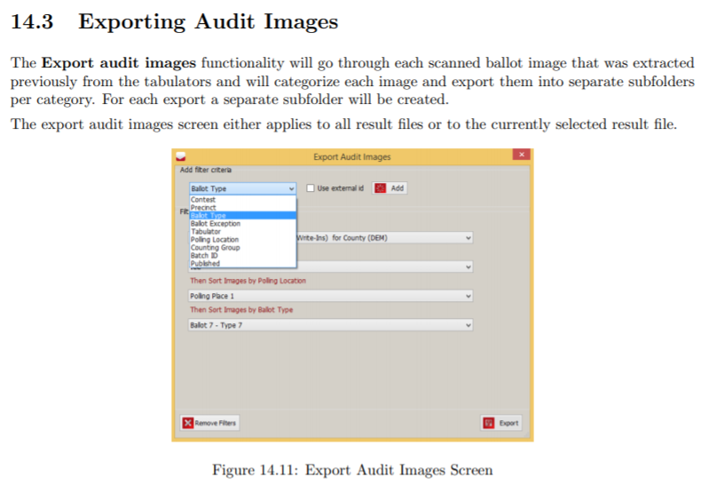

The manual describes the filter criteria as follows.

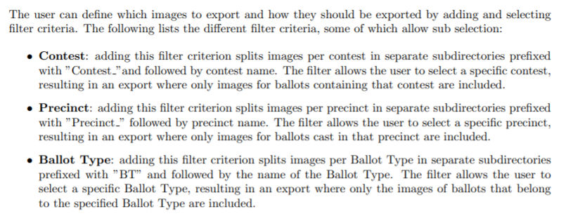

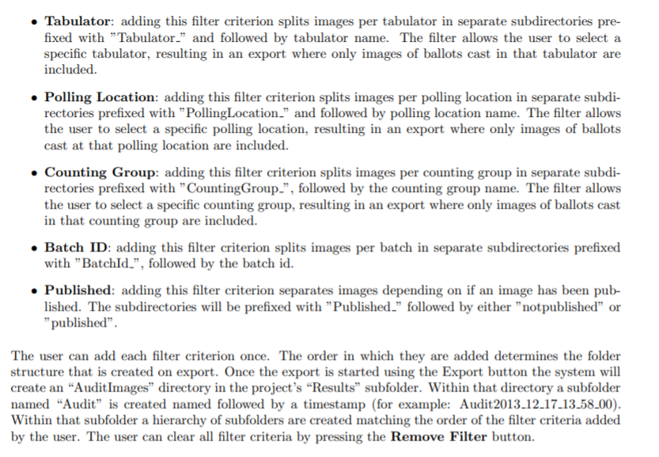

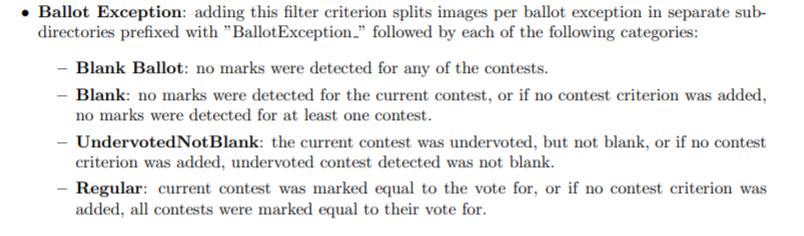

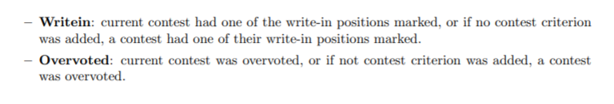

## Exporting Dominion cast vote records

This section is clipped from the Dominion User Guide, page 110.
AuditEngine needs only the JSON files, described in the manual as "a set of well-defined JSON files packaged together in a zip file."

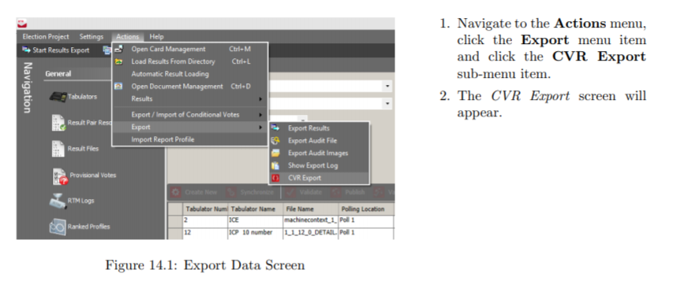

In the CVR Export screen, choose ALL for every filter. Then please:

- check "Create separate file per batch",
- check "Published batches only",
- uncheck "Use tabular format".

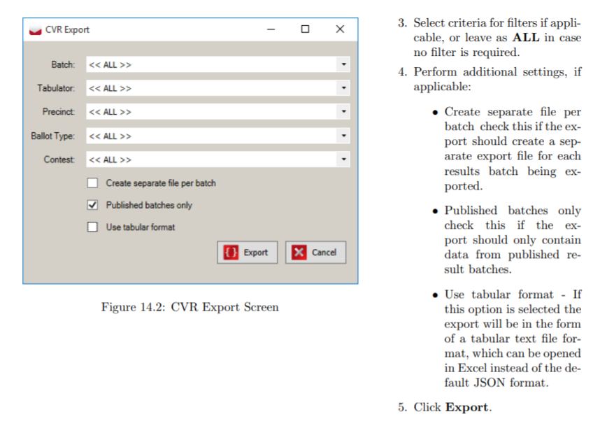

## Dominion CVR files

The latest generation of Dominion software produces the following CVR files.
Please zip them all into one ZIP archive.

```
BallotTypeContestManifest.json
BallotTypeManifest.json
CandidateManifest.json
Configuration.json
ContestManifest.json
CvrExport_0.json
CvrExport_1.json
    ... there may be hundreds or thousands of these
CvrExport_nnnn.json
DistrictManifest.json
DistrictPrecinctPortionManifest.json
DistrictTypeManifest.json
ElectionEventManifest.json
OutstackConditionManifest.json
PartyManifest.json
PrecinctManifest.json
PrecinctPortionManifest.json
TabulatorManifest.json
```

## Creating ballot style masters

These files were probably created to send to the printer.
So they are probably already in the files archived for this election.

In case they are not, here are the detailed instructions.
We do not need the audio files.

The rest of this section is excerpted from the Dominion documentation.
Our comments are in square brackets, [LIKE THIS].

### Chapter 5: Generating ballots for your election project

Once you have styled all of the properties needed for the proper generation of your ballots for your Election Project, proceed to the Ballots Generated stage. If you have not yet styled your ballots, return to Chapter 5 before continuing with this chapter.

#### 5.1 Generating official ballots

Once you are satisfied with the appearance and content of the ballots, you can proceed with the creation of the official ballot artwork and other elements such as audio files. [WE DO NOT NEED AUDIO FILES]

To generate official ballots:

1. Click Actions in the top menu. Click Create Ballots and Audio Files.

2. The Create Ballots and Audio Files screen appears, see Figure 5-1. It contains the available options for advancing into the next project phase, as well as general statistics and information about the project in its current state. The user can choose to create the following:

    - **Artwork for Paper Ballots.** This option is used for creating print-ready artwork for official paper ballots. [THIS IS THE OPTION WE NEED]
    - **Print Headers.** The headers are printed on the electronic ballots when the voter generates the ballot as part of completing their voting session. However, to speed up the process, headers are prepared in advance for each possible ballot manifestation. Headers for electronic mobile ballots are not created automatically. The creation of headers must be initiated by the user, and this can be performed only in Election Project Styling and Ballots Generated project phases. [NOT NEEDED]
    - **Full Face AVS Ballots (PNG).** This option can only be selected if Artwork for Paper Ballots has already been created, or is selected. This allows the user to create the necessary files for devices where electronic ballots can be displayed to the voter in the Full Face AVS mode (see Project Parameters 4.7). If there are tabulator types that support this mode of AVS, this option is still available in case PNG files are required. [NOT NEEDED]
    - **Audio Files.** This option is used for generating audio for all necessary election event objects. This audio is used for playback on the various voting devices where Accessible Voting Session modes are supported. [NOT NEEDED]
    - The user has the ability to specify which Languages the audio should be generated for. [NOT NEEDED]
    - The user has the ability to Overwrite existing audio files, in case they already exist. [NOT NEEDED]

    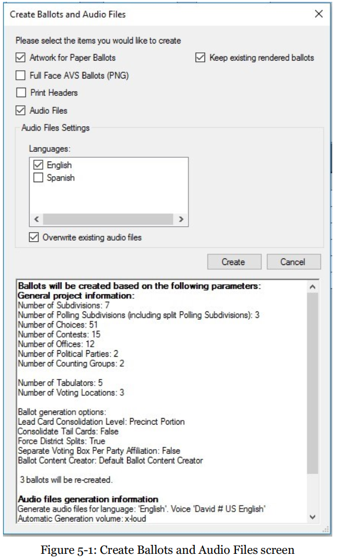

3. Click Create to begin the process. The system will collect data from your definitions and calculate the ballots that need to be created. This process can take a significant amount of time depending on the number of precincts, contests, choices, etc. [YES, DO THIS]

    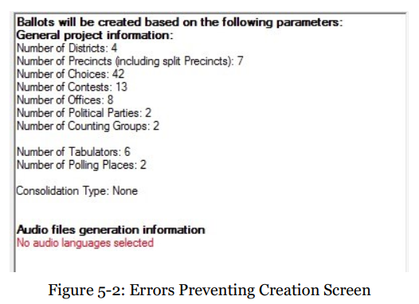

4. Note that if you have not properly defined and styled your Election Project, an error will appear, see Figure 5-2. This screen will list the components of your Election Project that are inconsistent or improperly defined. Use the list as a reference for addressing the errors that may be preventing your Election Project from generating ballots.

5. Note that you may come across a warning, see Figure 5-3, that lists potential errors that could occur once ballots are generated. Click Close.

    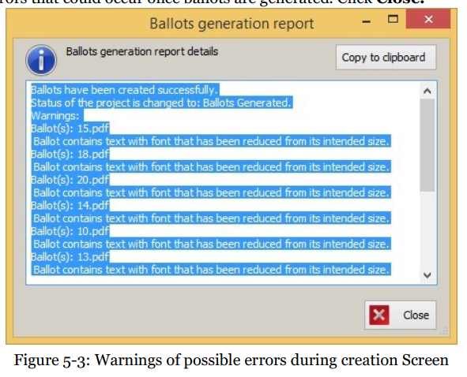

6. Once ballot content has been generated successfully, without any warnings, you will receive a confirmation dialog, see Figure 5-4. Click Close to continue. Your Election Project will now enter the Ballots Generated stage.

    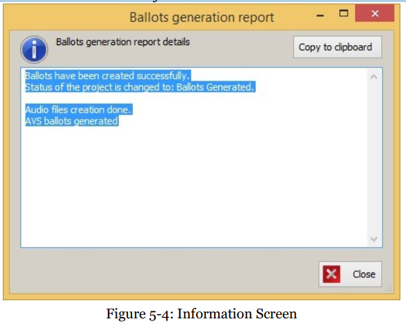

### What the ballot style masters look like

Here is a typical list of the first few files generated.

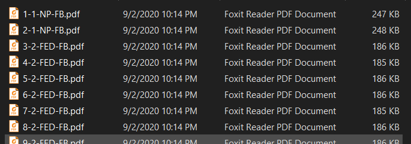

Each of these PDF files is "searchable."
You can tell because you can select text in it.
It is not just a picture of the ballot.

Here is part of a PDF page generated by the Dominion Voting System for Bartow County.

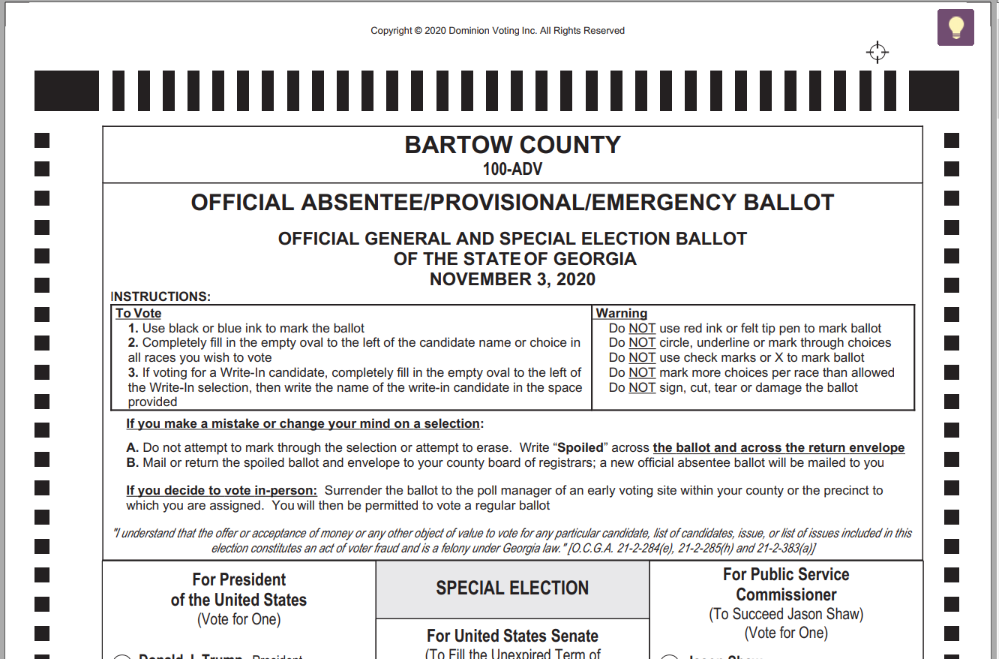

Note the timing marks around the edge.
Most important, there is a barcode at the bottom.

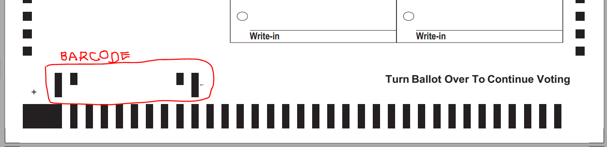

### Exporting EDM data

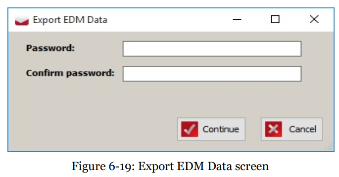

1. The system will ask for confirmation whether to continue creation of the EDM package, see Figure 6-20. If the user confirms, the system will start producing the EDM package.
2. Once finished, the EED will inform the user that the EDM package was exported successfully, see Figure 6-21.

## Packaging and sending the data

Put all the ballot style masters in a folder, and zip it in the usual ZIP format.
We recommend the free tool from [7-zip.org](https://www.7-zip.org/).
Please use the .zip format, not the .7z format.

AuditEngine has an uploading utility that lets you "set up and forget" the upload of any number of files, of any size.
It is the least expensive and fastest way to get the data to us, and the least trouble for you.

We can send you an upload link, so the data goes into the right folder.
If the link is not in your cover letter, just ask our support staff for it.

For detailed instructions, see [Sending Election Data to AuditEngine](sending_data.md).

[^1]: [Dominion EMS RTR User Guide](https://www.sos.state.co.us/pubs/elections/VotingSystems/DVS-DemocracySuite/documentation/EMS_RTR_UserGuide.pdf), page 131 of the PDF file, page 119 of the document. This is an older manual, but the newer software interface should be similar.
