# Election Systems & Software (ES&S): Exporting Guide

Ray Lutz, Citizens' Oversight. Version 6, 2022-06-15.
Contact: <support@citizensoversight.org>

[Download this guide as a PDF](https://auditengine.org/docs/pdf/ess_exporting_guide.pdf)

AuditEngine performs ballot image audits.
To audit an election independently, we need the district to export the ballot images and the CVR files.
The instructions below show how to export these files.
A separate page, [Sending Election Data to AuditEngine](sending_data.md), explains how to send them to us.

ES&S is a leading supplier of voting machines and election software, and AuditEngine can audit its elections.

## 1. Exporting ES&S ballot images

The following is from the ES&S documentation on ElectionWare.
It is in Chapter 3, "Produce Module", under "Exporting the Ballot Table, Ballot Images and CVRs".
These instructions may not match your system exactly.

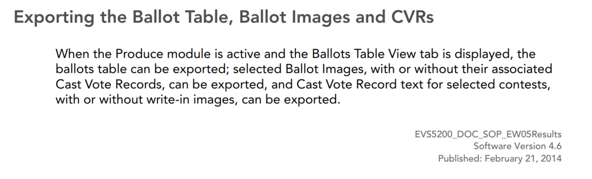

We don't need the "Ballot Table".

ES&S uses the term "Cast Vote Records" for two different things.

- One is a PDF file for each ballot. It has the same name as the ballot image, with a "c" added after the ballot number. It shows how the election system evaluated the votes on that ballot. It is produced along with the ballot images.
- The other is a spreadsheet with the .xlsx extension. It lists all the ballots and how the election system evaluated the votes on each.

To tell them apart, this guide calls the PDF files "cast vote record PDFs" and the spreadsheets "CVR spreadsheet files."

Follow these instructions to export the ballot images.
The numbers refer to the numbered paragraphs in the clippings below.

- **Paragraph 2.** Select "Include Non-Geographic Precinct Ballots".
- **Paragraph 3.** Select "Include Cast Vote Records". This includes the cast vote record PDFs.
- **Paragraph 4.** Do not add a watermark to the images.
- **Paragraph 5.** Select all districts, but only a few at a time, so the ZIP files are not too large. Aim for about 5 to 10 GB, or 20,000 to 50,000 ballots, per archive. Some versions of the software split the records into files of a reasonable size on their own.
- **Paragraph 6.** Select all parties.
- **Paragraph 9.** Choose file names like (County)BallotImages.zip, (County)BallotImages-1.zip, (County)BallotImages-2.zip and so on, where (County) is the name of the county. This may be automatic.

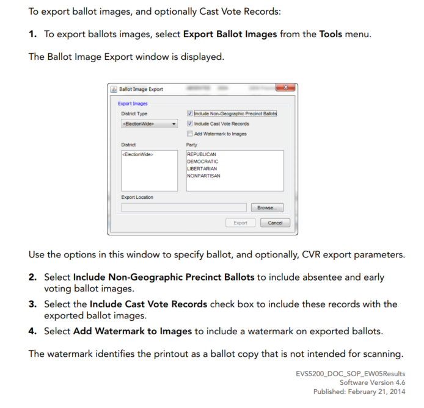

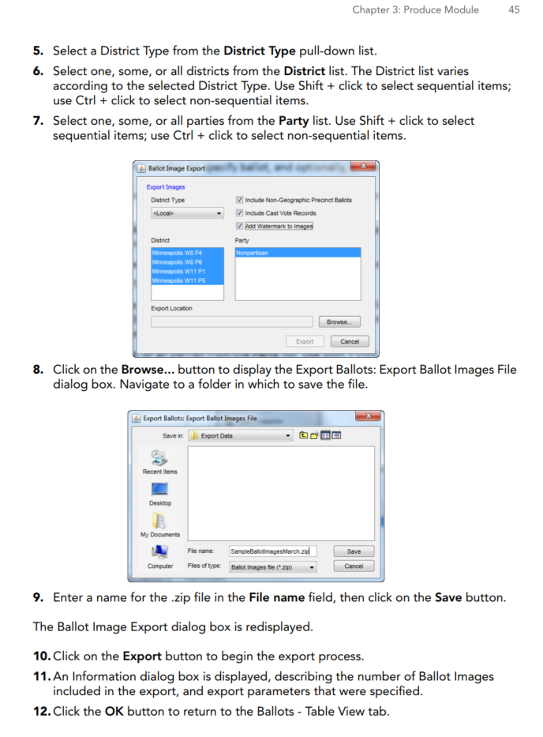

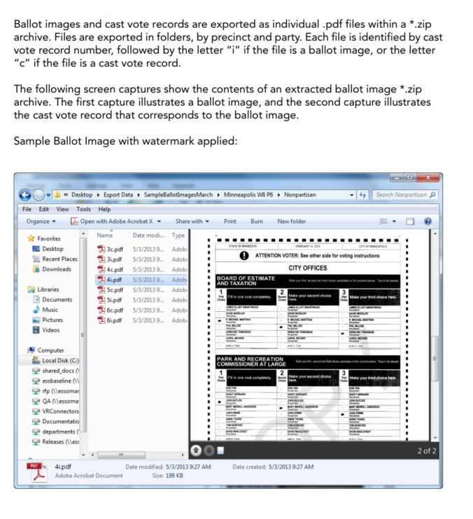

The next clipping is about the cast vote record PDFs, which are exported with the ballot images.
It is not about the CVR spreadsheet files.

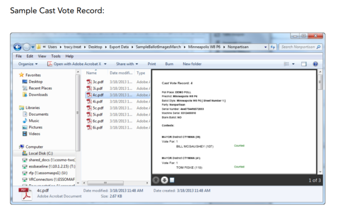

## 2. Exporting ES&S CVR files

ES&S saves the cast vote record tables as Excel spreadsheets, with the .xlsx extension.
They have one record per ballot sheet.

- **Paragraph 2.** Select all contests.
- **Paragraph 3.** Select "Include Write-In Images".
- **Paragraph 4.** Some versions of ElectionWare split the file into chunks of 100,000 lines, which is 99,999 ballots. If yours does not, please limit each file to that size, for ease of handling.
- **Paragraph 5.** Use names like (County)-CVR.xlsx, (County)-CVR-1.xlsx and so on, where (County) is the name of the county. This may be automatic.

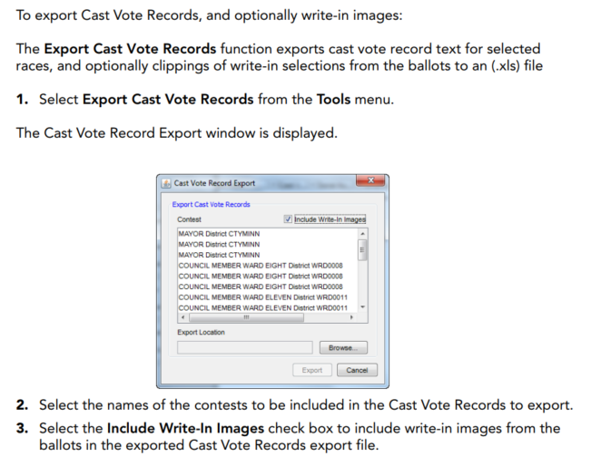

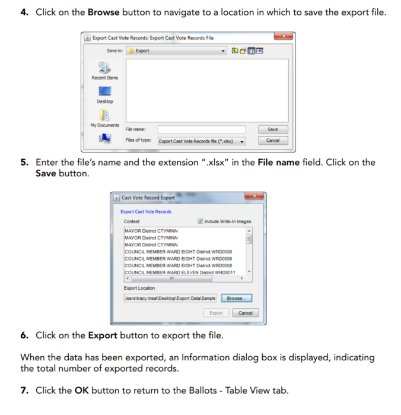

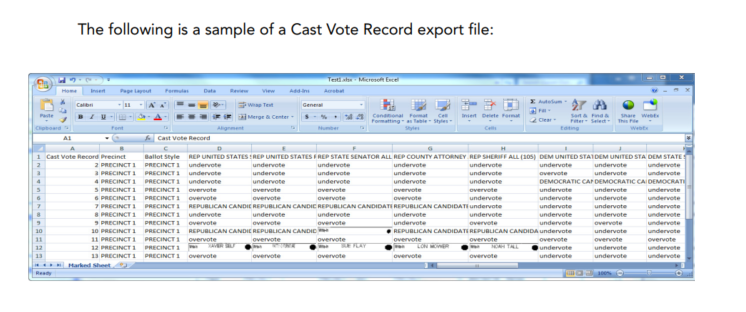

Please make sure the CVR file includes the "Ballot Style" field.

## 3. Exporting ballot style masters

PDF ballot style masters are the files sent to the printer to create the official ballots.

We need these PDF files in "searchable" format, not as plain bitmaps.
Searchable files let us map the targets on the ballots without error.
They must have the timing marks and style indications, just like the official ballots.

Please put them in a single ZIP archive, and upload it using your upload link.

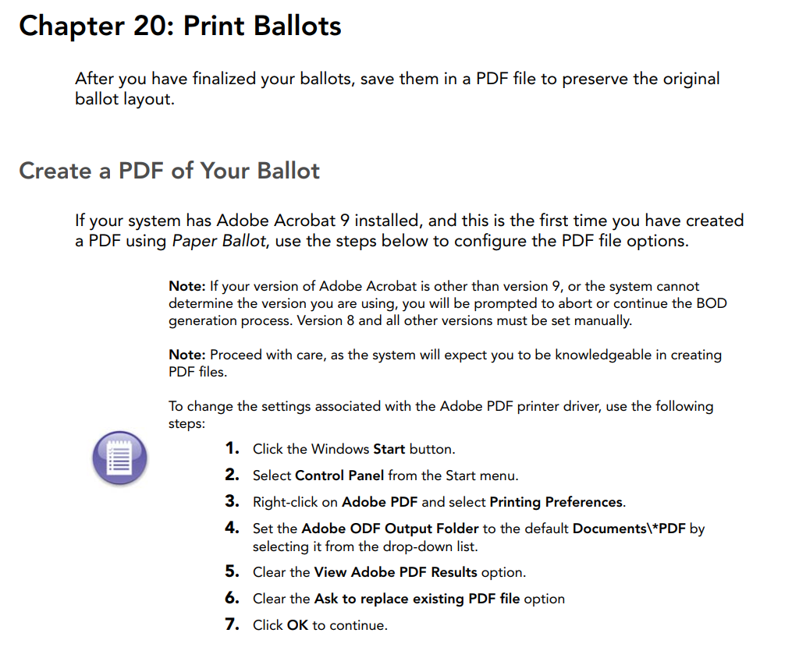

## 4. Exporting digital poll tape reports

The ES&S system can reprint "Results Reports", which are stored in the ElectionWare election management system.
These reports are existing records, and the system creates them as part of its normal work.
So they are subject to public records requests.
We recommend that election officials create these reports and post them for the public to review.

1. Open ERM, the Election Reports Manager.
2. Select the election.
3. On the top bar, click Tabulators.
4. Select DS200.
5. Select "Reprint DS200 Reports".
6. Enter the qualify code for that election. The box below appears.

    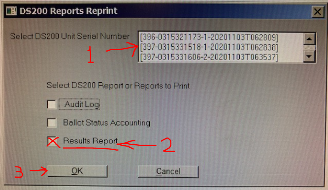

7. Run the report for one machine at a time. Each time:
    - select one of the DS200 serial numbers,
    - check "Results Report",
    - click OK.
8. The reports are now in the Report File Utility.
9. Process each report the way you process other reports, such as EL45A and EL30A. We prefer .TXT or .LST reports.
10. Repeat these steps for each DS200 in the election.

It may be possible to run the reports for all machines at step 7, and then process them all at steps 8 and 9.

## 5. BMD short contest names

AuditEngine reads BMD ballots with OCR, optical character recognition.
It does not rely on the barcodes.
So it needs the text strings that the BMD prints, especially the contest names.
These are limited in length, typically to 38 characters.

When you add a contest in ES&S ElectionWare, it has a field called "Tape Name", sometimes called the "Short Name".
For example, the title of a contest might be "Mayor of Possum Falls", while the tape name is just "Mayor".

There may be a report that lists the tape name for each title.
That report lets us set these up before a live election, without samples of BMD ballots.

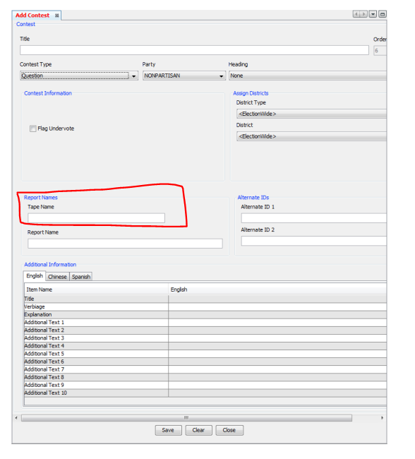
