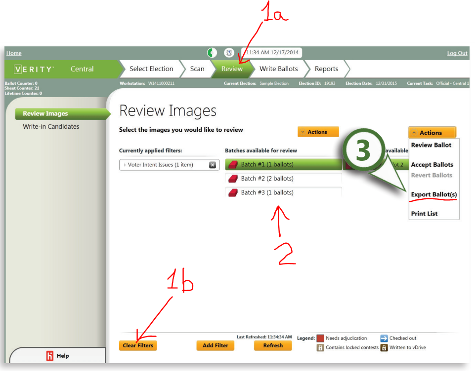
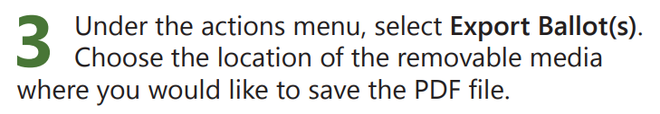
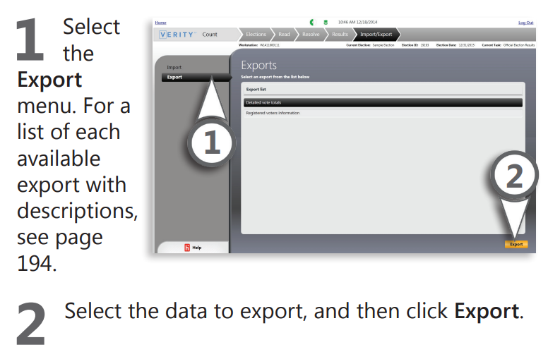
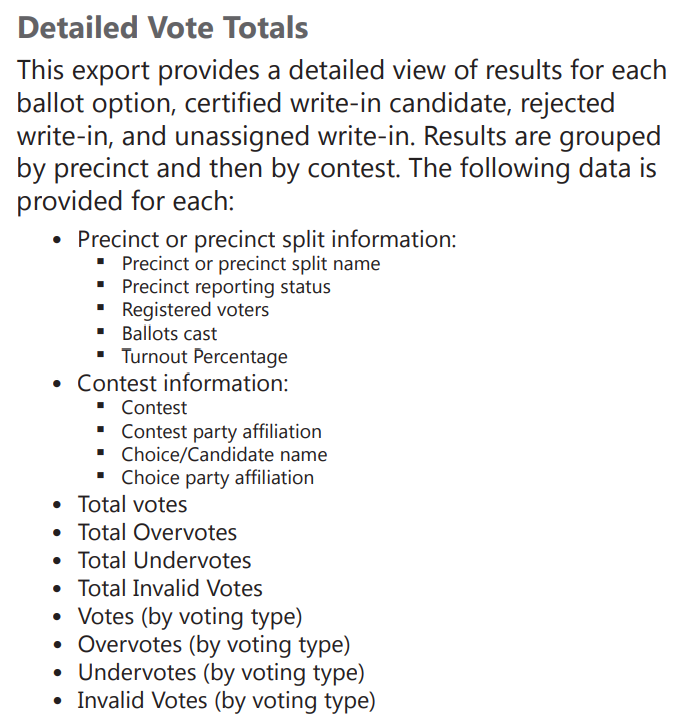
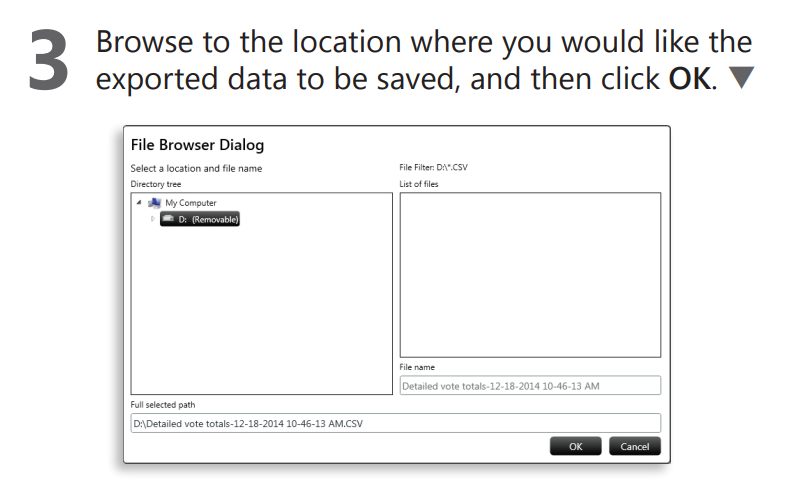
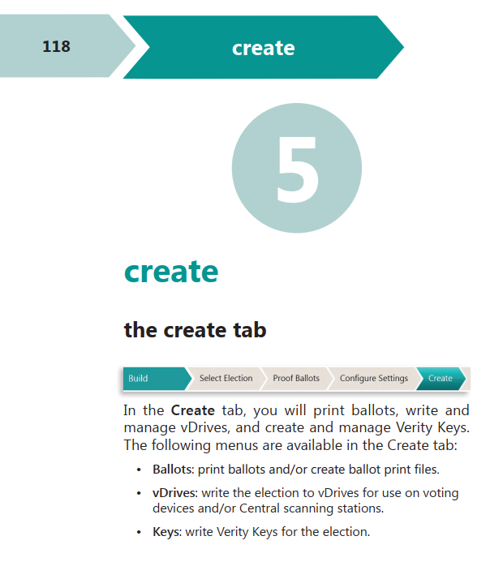
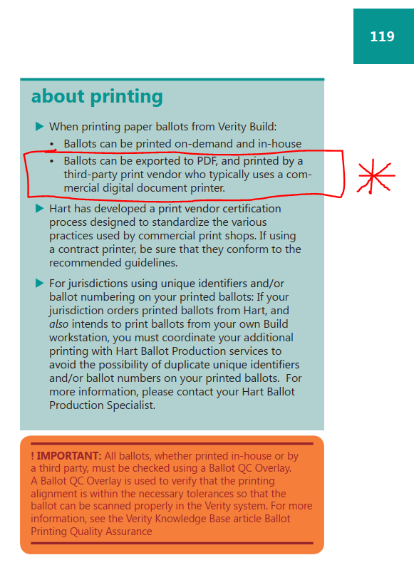
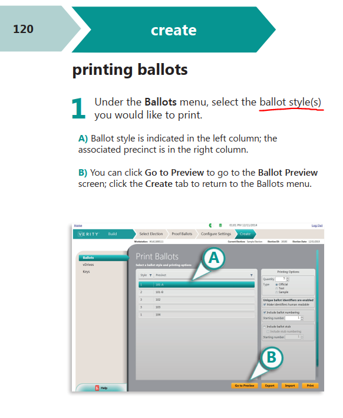
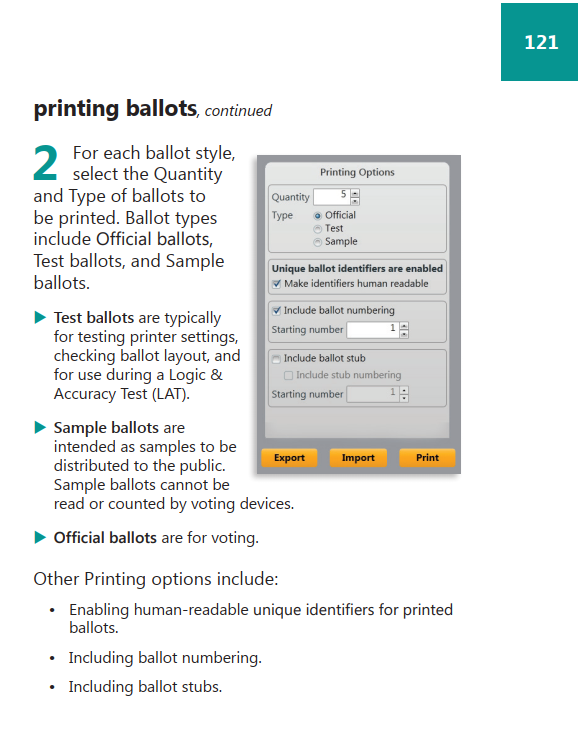
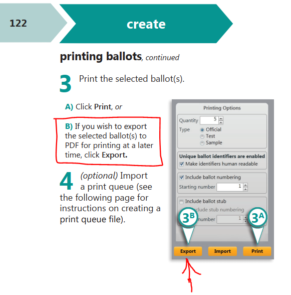

# Hart InterCivic: Exporting Guide

Ray Lutz, Citizens' Oversight. Version 2, 2022-06-15.
Contact: <support@citizensoversight.org>

!!! tip "PDF"
    [Download this guide as a PDF](https://auditengine.org/docs/pdf/hart_exporting_guide.pdf), to read offline or to attach to an email.

AuditEngine performs ballot image audits.
This guide shows how to export the files we need from the Hart InterCivic Verity system.
A separate page, [Sending Election Data to AuditEngine](sending_data.md), explains how to send them to us.

The instructions come from Hart's Verity manuals.
We believe they are accurate, but the software may differ from its documentation.
We do not have a copy of this software, so we welcome any corrections.

## 1. Exporting ballot images

Source: *Verity Administrator's Guide: Central*, © 2016 Hart InterCivic, page 133, "Exporting ballot images".
The state of Idaho once posted it. It is now available [from the Internet Archive](https://web.archive.org/web/20211019114052/https://sos.idaho.gov/elect/clerk/Hart/Verity2/6641-011%20A_Verity_2.X_Administrators%20Guide_Central.pdf).


Click Clear Filters to choose no filters, which selects all images.


Select batches in the second column.
Click a batch name, then use Shift-click or Control-click to add more batches.
Try to keep each group under about 50,000 images.





Choose a separate folder on the media for each group.
Zip each folder into an archive for easy handling, with up to about 50,000 images per archive.
Try to keep each archive at about 5 to 10 GB.

## 2. Exporting cast vote records

Source: *Verity Administrator's Guide: Count*, © 2016 Hart InterCivic, page 192, "Import/export: exporting data from Count".
It is available [from the Internet Archive](https://web.archive.org/web/20170222084302/http://www.sos.idaho.gov/elect/clerk/Hart/Verity2/6641-012%20A_Verity_2.X_Administrators%20Guide_Count.pdf).



Choose "Detailed Vote Totals", which the manual defines as follows.





The vote totals are exported as a .CSV file, with a name like this:

```
Detailed vote totals-12-18-2014 10-46-13 AM.CSV
```

## 3. Creating ballot style masters

Source: *Verity Administrator's Guide: Build*, © 2016 Hart InterCivic.
It is available [from the Internet Archive](https://web.archive.org/web/20170222084221/http://www.sos.idaho.gov/elect/clerk/Hart/Verity2/6641-010%20A_Verity_2.X_Administrators%20Guide_Build.pdf).

Export the ballots to PDF, in the format suitable for printing by a third-party print vendor.
The manual describes this starting on page 118, under the Create tab.





Under the Ballots menu, select all the ballot styles.
We believe you can select the first style, then Shift-click the last style.
Control-A, to select all, might also work.





On the right side of the screen is a dialog box, which applies to each style.
Please make these selections:

- Quantity: 1
- Type: Official
- Uncheck "Make identifiers human readable".
- Uncheck "Include ballot numbering".
- Uncheck "Include ballot stub".

Then click Export, and save to a PDF.

You should probably not use unique identifiers on ballots.
This is set in Election Preferences, described on page 75 of the manual.
Uncheck "Make ballots unique with an identifier in the barcode", and save.



## Packaging and sending the data

Put all the ballot style masters in a folder, and zip it in the usual ZIP format.
We recommend the free tool from [7-zip.org](https://www.7-zip.org/).
Please use the .zip format, not the .7z format.

We can send you an upload link, so the data goes into the right folder.
If the link is not in your cover letter, just ask our support staff for it.
We can create a single upload link for each county, which stays the same from one election to the next.

For detailed instructions, see [Sending Election Data to AuditEngine](sending_data.md).

## Requesting these files by public records request

If you are requesting these files from an election department, you can use the following public records request.
Such requests are sometimes called FOIA requests.

```
NAME, TITLE
COUNTY County
ADDRESS
CITY STATE ZIP
PHONE
EMAIL

RE: PUBLIC RECORDS REQUEST OF ELECTION DATA

Dear NAME, TITLE:

Please reply promptly to this email to acknowledge receipt of this
PUBLIC RECORDS REQUEST.

For the DATE (type: General, Special, Runoff, etc.) Election:

BALLOT STYLE MASTERS: Please provide the Ballot Style Masters, in
searchable PDF format, including the style barcodes, for this
election. These files are probably already produced for this election
and should be archived with the other data you must preserve. However,
if you cannot find them, please see this document for instructions,
which are specific to the Hart InterCivic Verity election management
system:
https://auditengine.org/docs/user-guide/hart_exporting_guide/
```
